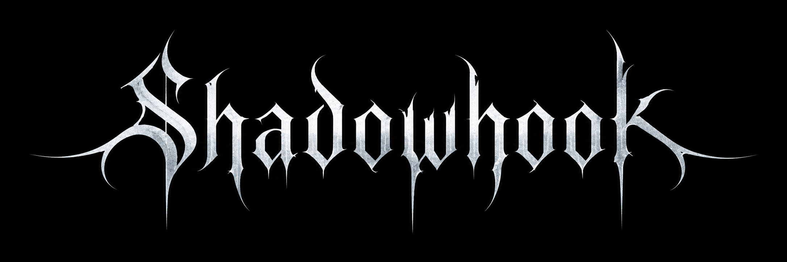
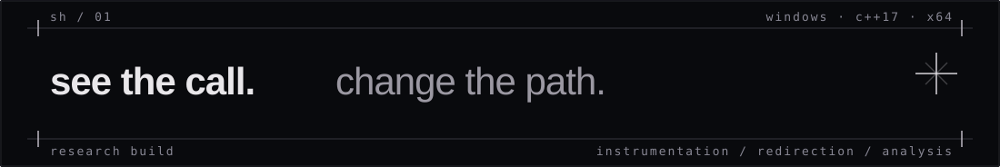
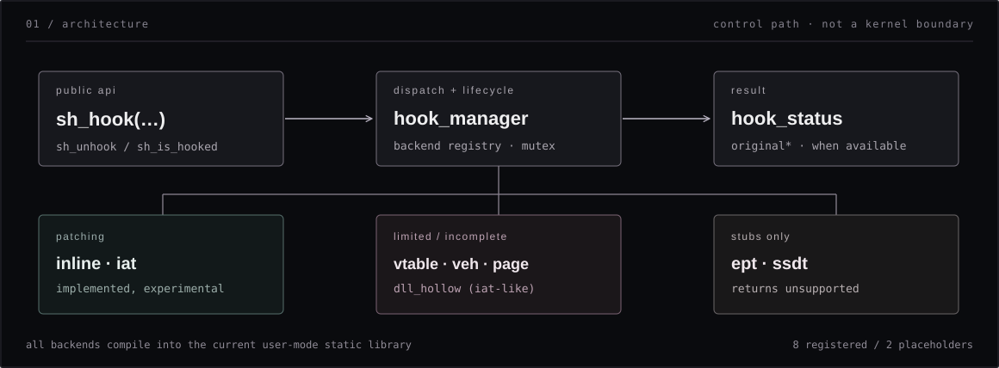
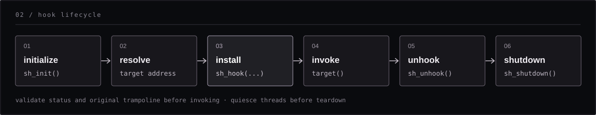
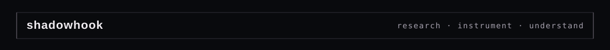

<div align="center">





<br />

<sub>experimental windows instrumentation · function redirection · backend-driven design</sub>

<br /><br />

[overview](#overview) &nbsp;·&nbsp; [architecture](#architecture) &nbsp;·&nbsp; [quick start](#quick-start) &nbsp;·&nbsp; [usage](#usage) &nbsp;·&nbsp; [backends](#backends) &nbsp;·&nbsp; [limitations](#limitations)

</div>

---

> [!IMPORTANT]
> **Hardening API update:** sh_init() supplies a cooperative execution domain.
> Every full inline target/original call must use shadowhook::enter_inline_execution().
> Eligible V1 flags=0 unwind prologues have registered relocated metadata; unsupported
> formats fail closed. Published original code is retained for process lifetime.
> See [current runtime contracts](docs/runtime-backends.md).
> The API monitor now uses atomic IAT slot exchange.

## overview

**shadowhook** is an experimental windows x64 hooking library built in c++17. it exposes a small public api backed by a registry of interchangeable hook implementations. the repository is intended for learning, instrumentation, debugging, and authorized security research.

- **one entry point** — install, query, and remove hooks through `sh_hook` / `sh_unhook`.
- **multiple strategies** — inline patches, import-address-table replacement, vtable modification, and exception-based redirection.
- **observable state** — named backend statuses and configurable logging.
- **static integration** — cmake target `shadowhook` and a bundled `api_monitor` example.

> [!IMPORTANT]
> this is **research code, not a hardened hooking engine**. having a registered backend does not imply that it is complete, production-safe, or suitable for concurrent patching. in particular, ept and ssdt are placeholders returning `unsupported`.

## architecture



<details>
<summary>explore the source layout</summary>

```text
include/shadowhook/
  shadowhook.h             public entry points
  core/                    types, manager, hook abstractions
  ring3/                   inline, vtable, veh, dll_hollow
  ring0/                   page, iat, ept, ssdt declarations
  utils/                   memory, decoder, logging, scanning
src/
  shadowhook.cpp           registration + public api bridge
  core/                    manager and hook lifecycle
  ring3/                   user-mode hook backends
  ring0/                   mixed user-mode code and stubs
  utils/                   memory, logging, instruction helpers
examples/
  api_monitor.cpp          messageboxa instrumentation demo
assets/
  logo.png                 project artwork
```

**note:** the `ring0/` directory name does **not** mean the cmake target is a kernel-mode driver. the project currently builds a user-mode static library.

</details>

## quick start

**requirements:** windows x64, cmake 3.16+, a c++17-capable msvc toolchain, windows sdk, and masm support for the x64 assembly source.

```powershell
git clone https://github.com/xvalegendary/ShadowHook.git
cd ShadowHook

cmake -S . -B build -G "Visual Studio 17 2022" -A x64
cmake --build build --config Release

.\build\Release\api_monitor.exe
```

this builds the **static library** `shadowhook` and the example executable `api_monitor`. the example hooks `MessageBoxA` in its own process, calls it, then removes the hook.

for an existing cmake application, add the repository as a subdirectory:

```cmake
add_subdirectory(external/ShadowHook)
target_link_libraries(my_app PRIVATE shadowhook)
```

`shadowhook` publishes its include directory through `target_include_directories`, so consumers can include `shadowhook/shadowhook.h`. the example is controlled by SHADOWHOOK_BUILD_EXAMPLES.

## usage



### inline hook · cooperative execution

sh_init() registers inline_hook with its own shared execution domain. An eligible
leaf or supported unwind-covered target can be installed through the normal API; every call path still needs
to enter the backend's domain BEFORE executing target/original code.

~~~cpp
sh_init();
auto& manager = shadowhook::hook_manager::instance();
auto status = static_cast<shadowhook::hook_status>(
    sh_hook(shadowhook::hook_type::inline_hook, target, detour, nullptr));
if (status != shadowhook::hook_status::success) return;

auto original = manager.pin_inline_original(target);
{
    auto executing = shadowhook::enter_inline_execution();
    if (!executing) return;
    reinterpret_cast<function_pointer>(target)();
    if (original) original.as<function_pointer>()();
} // full call has returned; unhook can now acquire quiescence
sh_unhook(target);
sh_shutdown_checked();
~~~

A default domain is not a process-wide stop-the-world mechanism: unregistered
threads/callbacks are not coordinated. Unwind-sensitive/unsupported prologues
remain rejected. See [contracts and migration](docs/hardening.md).

api_monitor uses IAT exchange for MessageBoxA. The manual --inline-demo mode
demonstrates the default inline path on a controlled leaf function.

CMake builds no tests: CTest registration and all test/probe targets are removed.
Existing test source files are retained without being compiled.

### native hotpatch mode

For unguarded callers at explicitly prepared x64 sites, use hook_type::hotpatch. It atomically switches an aligned two-byte NOP entry through an immutable relay; unsupported layouts are rejected. This is not a generic arbitrary-prologue patcher. See [required site contract and process-lifetime retention](docs/hotpatch.md). Run api_monitor --hotpatch-demo for the manual concurrent example.

### api reference

| call | purpose |
| :-- | :-- |
| `sh_init()` | register available hook backends |
| `sh_hook(type, target, detour, original)` | attempt to install one hook; returns an integer `hook_status` |
| `sh_unhook(target)` | remove a hook by its original target address |
| `sh_unhook_all()` | ask every registered backend to remove its hooks |
| `sh_is_hooked(target)` | return `1` or `0` for tracked hooks |
| `sh_dump_status()` | log active counts by backend |
| `sh_set_log_level(level)` | set logger verbosity using the logger's integer enum values |
| `sh_shutdown()` | attempt cleanup through the manager |

`sh_hook` and `sh_unhook` use values from `shadowhook::hook_status`, including `success`, `already_hooked`, `not_hooked`, `invalid_address`, `alloc_failed`, `protect_failed`, `unsupported`, and `partial`. only treat `success` as a successful installation.

## backends

| backend | behavior / scope |
| :-- | :-- |
| `inline_hook` | patches a function entry and creates a trampoline; relocation and thread-safety caveats apply |
| `iat_shadow` | rewrites the matching iat slot of the main executable, not every loaded module |
| `vtable` | explicit slot/method + bounded layout; private per-instance clone or explicit shared mode; legacy API remains shared slot 0 |
| `exception_veh` | persistent breakpoint dispatch with retained original trampoline; no single-step rearm |
| `page_shadow` | persistent breakpoint routes into an RX shadow dispatch island; not PTE remapping |
| `dll_hollow` | fully replaces an eligible private DLL image at the same base; typed image API, original snapshot and restore |
| `hotpatch` | atomic aligned entry switch; immutable relay and original body |
| `ept` | not ready |
| `ssdt_shadow` | not ready |

Registration depends on SHADOWHOOK_EXPERIMENTAL. EPT/SSDT remain stubs; their registration is not implementation.

See [vtable API, instance lifetime and RTTI contracts](docs/vtable-hooks.md) for instance-local usage.

## limitations

- **architecture:** code paths assume windows x64 (`rip`, `image_nt_headers64`, and x64 jump stubs). other architectures are not established as supported.
- **instruction rewriting:** RIP-relative operands, relative calls/jumps and Jcc are relocated for the decoded subset; unknown encodings and unsupported unwind formats are rejected.
- **execution safety:** patches, executable memory permissions, and hook removal need a robust concurrency and in-flight-call strategy before production use.
- **backend semantics:** registered backends vary substantially in completeness. directory names are not privilege boundaries.
- **cleanup reporting:** shutdown skips inactive backends; partial rollback retains runtime state and reports failure.
- **language boundary:** despite `extern "C"` linkage, the public header exposes a c++ enum parameter and is therefore a **c++ api** as currently declared.
- **validation:** this readme documents the current implementation; it does not imply a successful windows build or runtime test on every target build.

## development notes

begin with [`examples/api_monitor.cpp`](examples/api_monitor.cpp), then follow `sh_hook` into [`src/shadowhook.cpp`](src/shadowhook.cpp) and [`src/core/hook_manager.cpp`](src/core/hook_manager.cpp). each implementation lives under `src/ring3/` or `src/ring0/` and derives from the common backend abstraction.

for trustworthy hook engines, prioritize disassembly and relocation correctness, atomic patch strategies, page-protection restoration, instruction-cache coherency, module lifetime, and structured teardown. **correctness before stealth.**

## license

released under the [mit license](LICENSE).

<div align="center">
  
</div>
